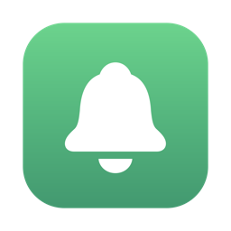

<p align="center"></p>

<h1 align="center">PhoneNotify</h1>
<p align="center">iPhone 的微信、短信、来电，实时推送到 Mac —— 不依赖苹果的「接力」，更快更稳。</p>

一块 **ESP32-S3 开发板**（约 25 元）插在 Mac 上，在 iPhone 看来它是一块「智能手表」，
iPhone 会把所有通知通过蓝牙（Apple ANCS 协议）实时交给它，再经 USB 转给 Mac 弹出。

## 功能

| | |
|---|---|
| 🔔 实时通知 | 微信 / 短信 / 来电 / 任何 App，延迟 < 0.5 秒；手机上清掉，Mac 上同步消失 |
| 📞 来电 | Mac 上弹窗直接 **接听 / 挂断** |
| 🔑 验证码 | 自动识别并复制到剪贴板 |
| ⭐️ 规则 | 按 App / 联系人 / 关键词设为「重要 / 静默 / 忽略」，免打扰时段 |
| 🗣 语音播报 | 来电、重要消息念出来 |
| 🎵 正在播放 | 显示 iPhone 正在放的歌，Mac 上切歌、调音量 |
| 🔋 电量 | iPhone 电量，低电提醒 |
| 🚶 离开 / 回来 | 带手机离开：暂停视频直播、静音、锁屏；回来可选自动亮屏 |
| 🤖 Claude Code | 工作中 / 等你确认 / 完成 —— 板载彩灯 + 弹窗提醒 |
| ⌨️ 实体按键 | 板子 BOOT 键单击/双击/三击/长按，可设任意 Mac 快捷键（板子充当 USB 键盘） |
| 📨 离线转发 | Mac 睡眠或程序没运行时，板子通过 Wi-Fi 把通知转发到 Telegram |
| 💡 提醒灯 | 未读微信绿、短信蓝、来电红闪 |

做不到（iOS 限制）：回复消息、让手机响铃、读取聊天记录。

## 安装（新电脑）

**1. Mac 程序**

```bash
curl -fsSL https://raw.githubusercontent.com/NorwayXZ/PhoneNotify/main/install.sh | zsh
```

或在 [Releases](https://github.com/NorwayXZ/PhoneNotify/releases) 下载 `PhoneNotify-macOS-*.zip`，解压拖进「应用程序」。
程序未经苹果公证，首次打开若被拦截：右键 → 打开，或执行 `xattr -cr /Applications/PhoneNotify.app`。
支持 macOS 13+，Apple 芯片和 Intel 均可。

**2. 板子固件**（每块新板子做一次）

买 **ESP32-S3** 开发板（如 ESP32-S3-N8R2，带两个 Type-C 口），插上 Mac：

```bash
git clone https://github.com/NorwayXZ/PhoneNotify && cd PhoneNotify && ./flash-firmware.sh
```

烧完后把线插到板子标 **USB** 的那个口（不是 COM/UART）。

**3. 与 iPhone 配对**（每块新板子做一次）

iOS 的蓝牙设置里看不到这类自制设备，需要用配套的小 App 发起配对（需要 Xcode + 免费 Apple ID）：

```bash
DEVELOPMENT_TEAM=你的TeamID ./iOS/build.sh
```

iPhone 上信任开发者 → 打开「Mac通知」→ 弹出配对点「配对」、通知共享点「允许」。
配对信息保存在板子和 iPhone 里，之后断电重插会自动重连，这个 App 可以删掉。

> 同一块板子换到另一台 Mac 上直接插就能用，不用重新配对。

## 使用

- 菜单栏铃铛：**绿色** = 已连接 iPhone，**白色** = 未连接
- 打开「PhoneNotify」显示控制面板：概览、通知记录、规则与播报、离开与返回、按键与快捷键、Claude Code、离线转发、设备与设置
- 点击通知弹窗可展开全文，并可复制 / 查看记录

### Claude Code 提醒（可选）

在 `~/.claude/settings.json` 的 `hooks` 里加入：

```json
"UserPromptSubmit": [{"hooks":[{"type":"command","command":"curl -s -m 1 -X POST --data-binary @- http://127.0.0.1:47800/claude/working >/dev/null 2>&1 || true"}]}],
"Notification":     [{"hooks":[{"type":"command","command":"curl -s -m 1 -X POST --data-binary @- http://127.0.0.1:47800/claude/waiting >/dev/null 2>&1 || true"}]}],
"Stop":             [{"hooks":[{"type":"command","command":"curl -s -m 1 -X POST --data-binary @- http://127.0.0.1:47800/claude/done >/dev/null 2>&1 || true"}]}],
"SessionEnd":       [{"hooks":[{"type":"command","command":"curl -s -m 1 -X POST --data-binary @- http://127.0.0.1:47800/claude/end >/dev/null 2>&1 || true"}]}]
```

## 目录

```
Sources/          Mac 程序（Swift / SwiftUI，单文件编译，无需 Xcode 工程）
esp32/            板子固件（PlatformIO + Arduino + NimBLE）
iOS/              配对用的 iPhone 小 App（xcodegen）
build.sh          编译 Mac 程序（通用二进制）并安装到 /Applications
release.sh        编译全部并发布 GitHub Release
install.sh        新电脑一行安装
flash-firmware.sh 一键烧录固件
```

## 从源码编译

```bash
./build.sh                       # Mac 程序（需要 Xcode 命令行工具）
cd esp32 && python3 -m venv .venv && .venv/bin/pip install platformio && .venv/bin/pio run -t upload
```

## 为什么不直接用 Mac 自带蓝牙？

同一 Apple ID 下的 Mac 被 iPhone 视为「连续互通」设备，iPhone 不会把 ANCS 通知服务开放给它（实测：无论 Mac 当主机还是从机、是否重新配对都不行）。
一块独立的 ESP32 在 iPhone 眼里就是普通手表，因此可以拿到全部通知。
